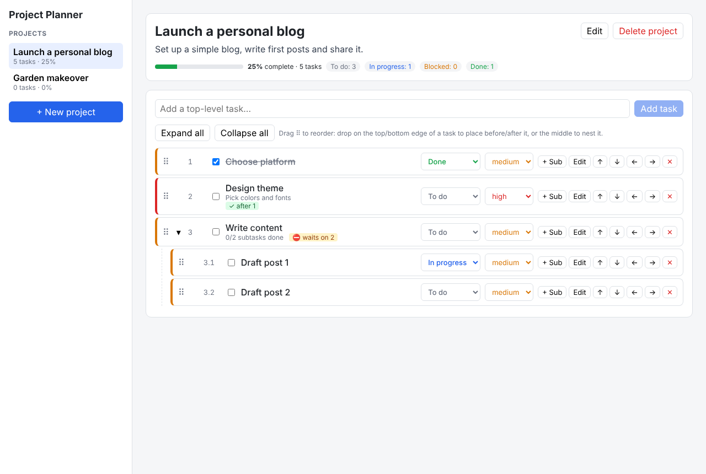

# Project Planner

A small frontend-only web app that turns a vague project idea into a concrete plan:
create a project, break it into tasks and subtasks, and see the whole breakdown as a numbered task tree.



## Features

- **Projects**: create a project with a title and short description. You can keep **multiple projects**, switch between them in the sidebar, and edit or delete each one.
- **Task tree**: top-level tasks and nested subtasks (any depth), numbered in outline form (1, 1.1, 1.2, 2…). Branches can be collapsed or expanded.
- **Add, edit and delete** tasks. The editor covers title, notes, status, priority and dependencies. Deleting a parent also deletes its subtasks, after a confirmation.
- **Metadata**: status (To do / In progress / Blocked / Done) and priority (low / medium / high, shown as a coloured left border).
- **Progress at a glance**: a project progress bar, counts per status, and "x/y subtasks done" on each parent.
- **Reordering**:
  - drag the ⠿ handle onto the top or bottom edge of a task to place it before or after that task, or onto the middle to nest it;
  - or use the buttons ↑ ↓ (move) and ← → (outdent / indent).
- **Dependencies**: mark that a task depends on other tasks. The task shows `⛔ waits on 2` while those tasks are unfinished, and `✓ after 2` once they are done.
- **Persistence**: everything is saved in the browser's `localStorage` (key `project-planner:v1`), so it survives a page refresh.

## Requirements

- Node.js 18 or later (and npm)

## Setup and run

```bash
cd project-planner
npm install
npm run dev
```

Then open the URL Vite prints, usually http://localhost:5173.

Other scripts:

- `npm run build`: production build into `dist/`
- `npm run preview`: serve that production build locally

## Project structure

```
src/
  main.jsx     React entry point
  App.jsx      UI: sidebar, project header, task tree, editors
  tasks.js     Pure task-tree logic: ordering, move/indent/outdent, delete, progress
  storage.js   localStorage load/save
  styles.css   Minimal styling
```

Tasks are stored flat as `{ id, title, notes, status, priority, parentId, order, dependsOn[] }`.
The tree is derived from `parentId` and `order`.

## Non-goals

There are no external integrations, no collaboration features, no scheduling or estimates, and no Gantt chart.
